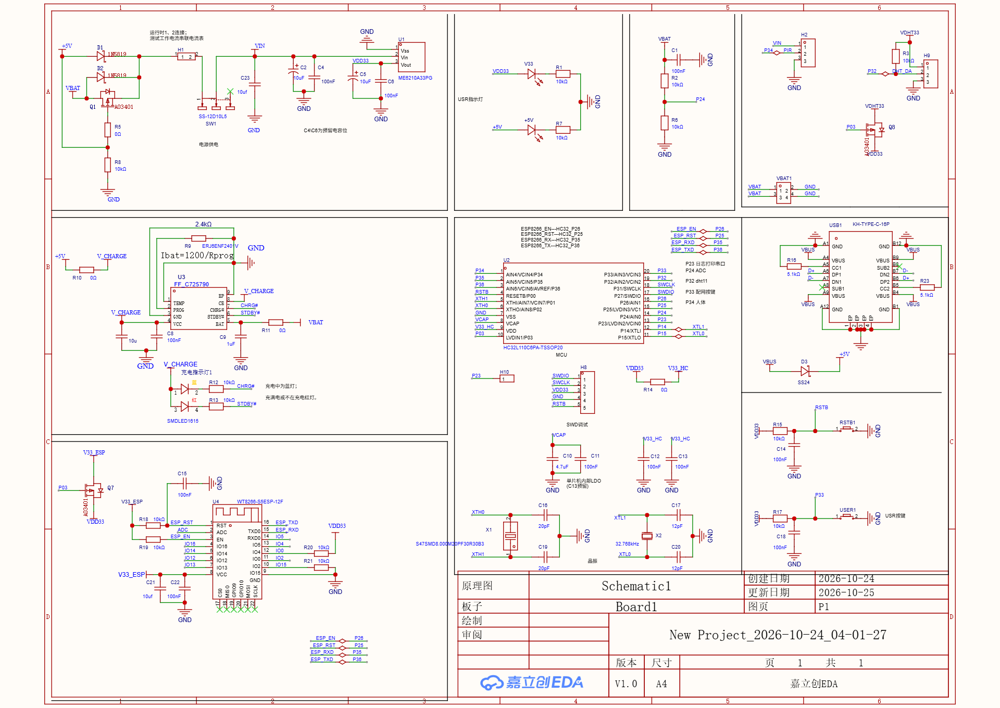
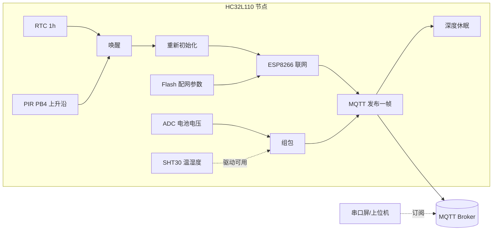
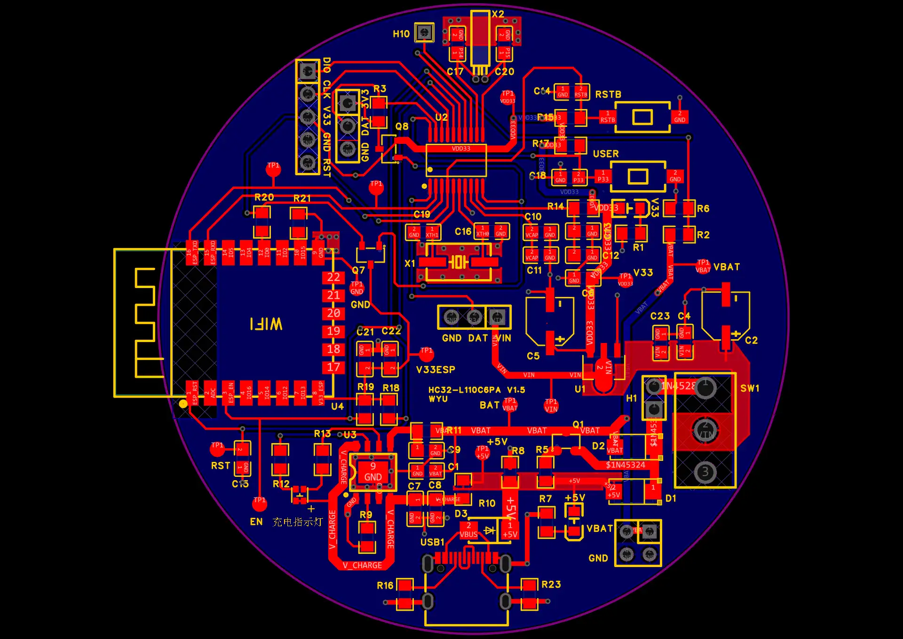

# 消防报警器（低功耗监测节点）· Fire Alarm Node

> 华大 HC32L110（Cortex-M0+）低功耗节点：SHT30 温湿度 + 电池电压采集，PIR 人体触发，
> 通过 ESP8266 走 MQTT 上报后立即进入深度休眠 —— 一块纽扣电池级别的功耗预算。




---

## 目录

- [1. 项目简介](#1-项目简介)
- [2. 功能与实现状态](#2-功能与实现状态)
- [3. 系统架构](#3-系统架构)
- [4. 硬件](#4-硬件)
- [5. 固件设计](#5-固件设计)
- [6. 通信协议与云端](#6-通信协议与云端)
- [7. 仓库结构](#7-仓库结构)
- [8. 编译与烧录](#8-编译与烧录)
- [9. 开源整理说明与已知问题](#9-开源整理说明与已知问题)
- [10. 许可证](#10-许可证)

## 1. 项目简介

目标是做一个能贴在墙上的**低功耗消防/安全监测节点**：平时深度休眠，靠 RTC 每小时醒一次、或者被 PIR 检测到人体时醒一次，醒来后连 Wi-Fi、连 MQTT、发一帧数据、再睡回去。

选 HC32L110 的原因是它够小够省电：TSSOP20、Cortex-M0+、4 MHz 主频就够跑传感器和串口、深度休眠电流在 µA 级。通信交给现成的 ESP8266（AT 指令 + MQTT），不用在 MCU 上移植协议栈。

一代硬件的实测结果（见第 2 节）说明：**通路打通了，但"报警"这件事还没做完**——这也是这个仓库最有价值的部分：它记录了一次真实的、未完成的迭代。

## 2. 功能与实现状态

| 功能 | 状态 | 说明 |
| --- | --- | --- |
| 低功耗休眠/唤醒 | ✅ 已实现 | RTC 1 h 周期中断 + PIR（PB4）上升沿中断 → 复位重启 → 重新联网上报 |
| 电池电压采集 | ✅ 已实现 | ADC 采样后 `(V−3.6)/0.6×100%` 换算为电量百分比，是该帧里唯一有效的模拟量 |
| Wi-Fi 配网 | ✅ 已实现 | 参数存 Flash（`ReadFlashWIFI()`），未配置时进入配网流程 |
| MQTT 连接与上报 | ✅ 已实现 | ESP8266 AT 指令 → `AT+MQTTCONN` → 发布一帧 JSON |
| SHT30 温湿度 | ⚠️ 驱动可用，未接入 | `SHT30_Init()/SHT30_Read()` 在 `main.c` 中被注释，上报的温湿度恒为 0.0 |
| 烟雾/火焰检测 | ❌ 未完成 | ADPD188BI 光学传感器只做了驱动验证，未接入主流程，PCB 上也没有该器件 |
| 阈值判定与声光报警 | ❌ 未完成 | 无蜂鸣器代码，LED 闪烁被注释，没有阈值比较逻辑 |
| 看门狗 | ⚠️ 未启用 | `WdtInit()` 被注释，但 LPTIM 中断里仍在 `Wdt_Feed()`，属于"喂了没开的狗" |
| 硬件与工程一致性 | ⚠️ 不一致 | 原理图/PCB 是 **HC32L110C6PA**，Keil 工程 Device 配的是 **HC32L130J8TA**（见第 9 节） |

## 3. 系统架构



## 4. 硬件



| 项目 | 内容 |
| --- | --- |
| 主控 | HC32L110C6PA（TSSOP20，原理图丝印 `HC32-L110C6PA_V1.5`） |
| 主频 | 4 MHz（RCH 内部高速时钟，HCLK/PCLK 均 1 分频） |
| 时钟 | RTC 用 XTL 32.768 kHz |
| 温湿度 | SHT30，I2C1（PA11/PA12，100 kHz，地址 0x44） |
| 人体检测 | PIR 模块，接 **PB4**（上升沿中断） |
| 电池检测 | ADC 通道，接 **P24** |
| Wi-Fi | ESP8266，UART0 9600 8E1；EN = P26，RST = P25；ESP 供电由 P03 经 AO3401 控制 |
| 调试 | UART1 日志 9600 8E1（P23） |
| 其它 | 按键、LED（PD5）、LPTIM 定时唤醒、看门狗（未启用） |

> 注意：`firmware/MDK` 里的两个工程文件把 Device 配成了 HC32L130J8TA（64 KB Flash），而板子实际是 L110C6PA。换板/换工程前请先核对，详见第 9 节。

原理图与 PCB 源文件（立创 EDA 专业版工程）：[`hardware/easyeda/消防报警器.epro2`](hardware/easyeda)。

## 5. 固件设计

### 5.1 主流程

`firmware/source/main.c`：

```c
delay1ms(2000);                 // 等电源稳定 / 给 ESP8266 上电时间
App_SysClkInit();               // RCH 4 MHz
Timer2Init();                   // TIM2 10 ms 节拍（PCLK/16, ARR=0x10000-2500）
Uart1Init(); Usart0_PortInit(); Uart0Init();   // 日志 + ESP8266
App_AdcPortInit(); App_AdcInit(); App_AdcSglCfg();
App_GpioInit(); App_UserKeyInit();
ESP8266_Init(); ESP8266_GetMAC();

if (ReadFlashWIFI() == 1) { /* 已配网：连 Wi-Fi */ }
else                     { /* 未配网：进入配网模式 */ }
ConnectMQTT(); MQTTPOST(); GetNtpTime();
App_LPTimerInit();
Gpio_EnableIrq(GpioPortB, GpioPin4, GpioIrqRising);   // PIR 唤醒源
...

while (1) {
    Wdt_Feed();
    if (FlagOneHour == 1) { /* 每小时：唤醒 ESP → 联网 → 发一帧 → 再睡 */ }
    else if (夜间 && 2 min 内首次检测到人) { /* 复位 ESP 后上报 */ }
    else if (夜间 && 2 min 内再次检测到人) { /* 直接上报，不重启 ESP */ }
    else { Wdt_Feed(); delay1ms(6000); }
    ESP8266_Sleep();
    Lpm_GotoDeepSleep(TRUE);     // 深睡，等下一次中断
}
```

### 5.2 "用复位当事件驱动"

这份代码里最特别的设计：**PIR 中断里不做业务，直接 `NVIC_SystemReset()`**。

```c
void PORTB_IRQHandler(void)
{
    ...
    NVIC_SystemReset();   // 醒来 = 重启 = 重新初始化 ESP8266 = 重新连 MQTT
}
```

好处是状态机极简——不需要处理"网络断了又醒"的各种状态；代价是每次事件都要付一次 ESP8266 冷启动（约 2–3 s）的代价，而且依赖 `FlagOneHour` 这类 RAM 标志跨复位失效（复位后确实清空，所以逻辑自洽）。

### 5.3 低功耗策略

| 策略 | 实现 |
| --- | --- |
| 深度休眠 | `Lpm_GotoDeepSleep(TRUE)`，使能"中断返回后自动再睡" |
| 唤醒源 | RTC 1 h 周期中断；PB4 PIR 上升沿；LPTIM |
| ESP 断电 | `ESP8266_Sleep()` 关 ESP 使能脚，避免休眠期间被 ESP 拉高电流 |
| 未用 IO | `sleep_GpioInit()` 把不用引脚配成高阻输入，防漏电 |
| 2 分钟上报窗口 | 夜间检测到人后开 2 min 窗口，窗口内后续触发直接上报（不重启 ESP），窗口结束再睡 |

## 6. 通信协议与云端

节点与 ESP8266 之间是 AT 指令；ESP8266 与服务器之间是 MQTT。

| 项 | 值 |
| --- | --- |
| ESP 波特率 | 9600 8E1（**注意不是常见的 115200 8N1**，模块参数需对应改过） |
| Broker | `YOUR_MQTT_BROKER_IP:1883`（原值已脱敏） |
| Client ID | 模块 MAC（`AT+CIPSTAMAC?` 取 15 字符）→ `YOUR_CLIENT_ID` |
| 发布 Topic | `/sys/thing/event/property/post` |
| 订阅 | `/ntp/<MAC>/response`（NTP 对时） |
| 上报方式 | `AT+MQTTPUBRAW=0,"<topic>",<len>,0,0` + 手工拼的 JSON |

上报报文（`user/8266.c` 的 `MQTTPOST()`）：

```json
{
  "Belong": "A",
  "NodeName": "<MAC>",
  "Timestamp": "1624448722000",
  "Temperature": 0.0,
  "Humidity": 0.0,
  "HumanDetection": "0",
  "FlameState": 0,
  "BatteryPercentage": 87
}
```

- `BatteryPercentage` 是唯一有真实数据的字段：`V = raw×3.3/4096`，再按锂电 3.6–4.2 V 映射到 0–100%（`(V×2−3.6)/0.6×100`，代码里按 2 倍分压反推）；
- `Temperature`/`Humidity`/`FlameState` 当前恒为 0（SHT30 未调用、无烟雾传感器）；
- `Timestamp` 是写死的字符串，和 NTP 对时结果无关；
- `HumanDetection` 直接读 PB4 电平。

> 仓库里的 Wi-Fi SSID、密码、Broker 地址、MQTT 账号密码**全部替换成了占位符**，直接编译是连不上的 —— 这是有意的：不要把账号密码提交到公开仓库。改 `firmware/user/MyApplication.h` 里的宏即可。

## 7. 仓库结构

```
fire-alarm/
├── README.md
├── LICENSE
├── docs/
│   ├── 01-status.md          # 迭代记录：做了什么、卡在哪、下一步
│   └── images/               # 原理图、PCB
├── firmware/
│   ├── README.md
│   ├── source/               # 工程实际编译的 main.c
│   ├── user/                 # 外设与业务：8266 / ADC / Flash / GPIO / UART / Timer0 / SHT30
│   ├── mcu/common/           # 芯片启动与中断向量（厂商 CMSIS 文件）
│   └── MDK/                  # Keil 工程 + 启动汇编
└── hardware/
    └── easyeda/              # 立创 EDA 工程（原理图 + PCB）
```

## 8. 编译与烧录

| 项目 | 值 |
| --- | --- |
| IDE | Keil µVision 5.24（MDK-ARM Plus 5.24.1） |
| 编译器 | ArmClang 6.7（另有工程记 6.12） |
| 器件包 | `HDSC.HC32L13x.1.2.0` |
| Target | `gpio_output_Release` |
| 体积 | Code 16 284 B / RO 1 176 B / RW 12 B / ZI 1 780 B（约 17.5 KB Flash、1.8 KB RAM） |
| 烧录 | CMSIS-DAP（`CMSIS_AGDI.dll`），Flash 算法 `FlashHC32L130_64K.FLM` |

编译前需要补的：`firmware/` 里**没有**华大 DDL 驱动库（`driver/`，第三方，遵循华大许可）。请安装 HC32L13x 器件包与 DDL，在 `MyApplication.h` 同级目录放回 `driver/`，或直接用官方 DDL 例程工程替换。

## 9. 开源整理说明与已知问题

**整理做了什么**

1. 编码统一为 UTF-8（原文件是 GBK），并统一为 LF 换行；
2. 账号密码/服务器地址全部替换成占位符（`YOUR_WIFI_SSID`、`YOUR_MQTT_BROKER_IP` 等）；
3. 剔除华大官方 DDL（`driver/`，2053 个文件）、SDK 安装包、`MDK/output`（94 个构建产物）、`*.uvguix.*`、`JLinkSettings.ini`；
4. 剔除未进入工程且不可编译的实验代码：`adpd188.c/h`（ADI no-OS 驱动）、`no_os_*.h`、`user/main.c`（上一代 L110 版本）、`i2csht30.*`、`usart_gps.*`、`get_gps.c`、`sht30-2.*`（其实是 ADS1115 的驱动）、`adpd188BI.c`。

**已知问题（都是真实的、未修的）**

| 问题 | 影响 | 建议 |
| --- | --- | --- |
| 工程 Device = HC32L130J8TA，板子 = HC32L110C6PA | 下载算法/存储映射不对，换工程可能编译过但跑不起来 | 新建 L110 工程，或把 Device 改回 HC32L110C6PA |
| 温湿度调用被注释 | 上报的温湿度恒 0 | 取消 `SHT30_Init/Read` 注释并接上组包 |
| 无烟雾传感器 | 与"消防报警器"的名字不符 | 二版加 ADPD188BI 或 MQ 系列 + 阈值判定 |
| 无阈值/蜂鸣器 | 只有上报，没有本地报警 | 加阈值比较 + 蜂鸣器/LED |
| 看门狗未启用 | 卡死无法自恢复 | 打开 `WdtInit()`（52.4 s 超时） |
| 夜间分支不可达 | `FlagNightPerson` 从未置 1 | 在 PIR 中断里置位，或直接改为唤醒标志 |
| 复位当事件驱动 | 每次事件 ~3 s 冷启动 | 二版改成状态机 + 保持 ESP 供电做快速重连 |

## 10. 许可证

代码以 MIT 发布（见 [LICENSE](LICENSE)）。`firmware/mcu/common/` 是华大半导体（XHSC）的 CMSIS 设备文件，版权与许可归华大；立创 EDA 工程中的器件符号/封装归各自厂商。
