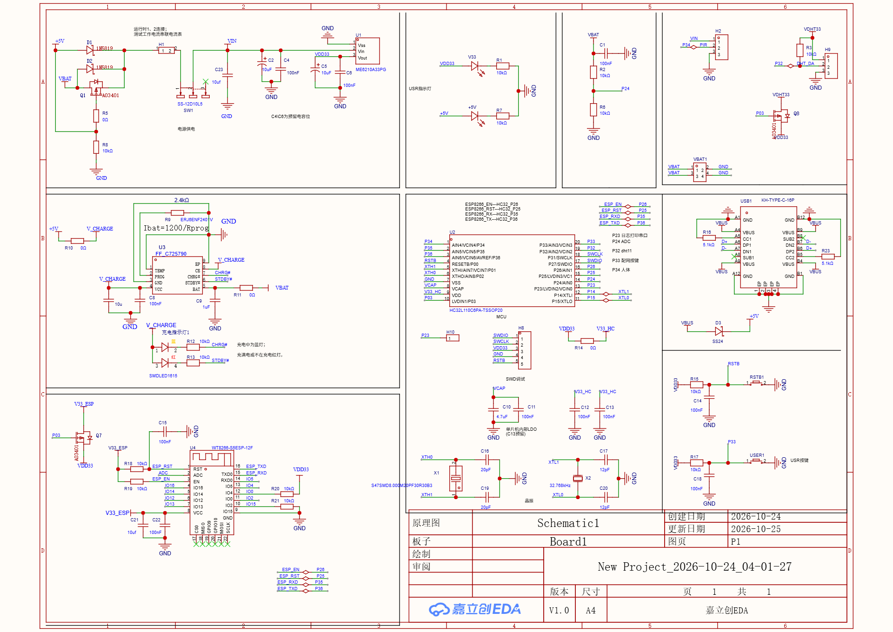

# 硬件说明

> 原理图与 PCB 图见 [`docs/images/`](../docs/images)：`原理图_Schematic1.png`、`PCB_Board1.png`（从立创 EDA 工程导出）。

## 文件

| 路径 | 内容 |
| --- | --- |
| [`easyeda/消防报警器.epro2`](easyeda) | 立创 EDA 专业版工程（原理图 + PCB），用立创 EDA 专业版打开 |
| [`../docs/images/原理图_Schematic1.png`](../docs/images/原理图_Schematic1.png) | 原理图整页导出图 |
| [`../docs/images/PCB_Board1.png`](../docs/images/PCB_Board1.png) | PCB 版图（圆形板）导出图 |

## 板级组成

| 模块 | 器件 | 说明 |
| --- | --- | --- |
| 主控 | HC32L110C6PA（TSSOP20） | 4 MHz RCH，XTL 32.768 kHz 供 RTC |
| 充电 | FF_CW725790 | `Ibat = 1200/Rprog`，Rprog = 2.4 kΩ ≈ 500 mA；双色 LED 指示充电/充满 |
| 接口 | USB-C KH-TYPE-C-16P | CC1/CC2 各 5.1 kΩ 下拉；D3 SS24 防反 |
| 电源 | 开关 SS-12D10L5 + LDO 3.3 V | 电池 → 开关 → LDO → VD033 → 0 Ω → V33_HC |
| Wi-Fi | ESP8266（排针/模块） | EN = P26、RST = P25、RX = P35、TX = P36；P03 经 Q7（AO3401）控制 ESP 供电 |
| 人体 | PIR 模块（H2 座） | P34，接 MCU PB4 |
| 温湿度 | 排针 H9 / H10 | P32（标注 dht11），另有 SHT30 走 I2C1（PA11/PA12） |
| 电池检测 | ADC 分压 | P24（代码用 PA00/PA01 两路扫描） |
| 按键/LED | 配网键 P33、网络指示 LED P03 | 长按配网键 2 s 触发配网 |
| 调试 | SWD（H8）+ 日志串口 P23 | 9600 8E1 |

## 设计要点

1. **ESP 可断电**：P03 → Q7（P-MOS）给 ESP 供电，休眠时切断，避免 ESP 待机电流吃掉整机功耗；
2. **ADC 参考用 AVDD**：电量检测精度取决于 3.3 V 稳压精度，故 LDO 后加 0 Ω 隔离模拟电源；
3. **32.768 kHz 晶振**：RTC 1 h 周期唤醒的时基，负载电容 12 pF；
4. **复位电路 + SWD**：调试用 CMSIS-DAP，注意烧录时选 32 KB Flash 算法（板子是 32 KB 的 L110）。

## 已知问题

- 原理图丝印是 HC32L110C6PA，但仓库里的 Keil 工程 Device 配的是 HC32L130J8TA（64 KB），下载算法不一致，详见根 README 第 9 节；
- 原理图上没有烟雾传感器接口（ADPD188BI 只做过驱动验证，未上板）。
